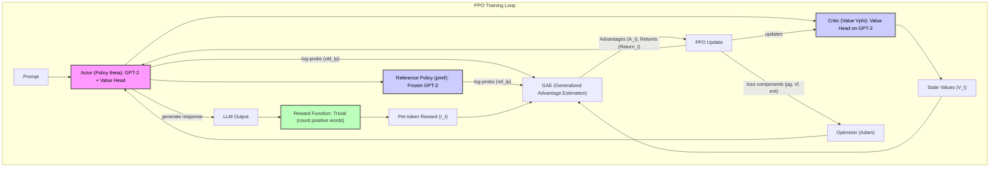

# Architecture Overview

This document outlines the high-level architecture, main data flows, and module connections within the RLHF (Reinforcement Learning from Human Feedback) End-to-End PPO (Proximal Policy Optimization) and Reward Modeling process for Large Language Models (LLMs).

## Main Flows

This repository implements a "glass-box" approach to PPO on an LLM, making every tensor visible. The core process involves the following key stages within a training loop:

1.  **Rollout**: The **Actor (Policy)** generates responses to prompts. During this phase, the **Critic** provides value estimates, and the **Reference Policy** provides baseline log-probabilities for KL divergence calculation.
2.  **Reward Shaping**: The generated responses are evaluated by a **Trivial Reward Function** (e.g., counting positive words). This raw reward is combined with a per-token KL penalty against the **Reference Policy** to form the final rewards.
3.  **Advantage Calculation**: Generalized Advantage Estimation (GAE) is used to compute advantages and returns from the shaped rewards and the **Critic**'s value estimates.
4.  **PPO Update**: The **Actor (Policy)** and **Critic** are updated using the PPO-Clip algorithm, which involves calculating the importance ratio, clipping, and optimizing a combined policy and value function loss. This process is iterative over several PPO epochs.

## Module Connections and Protocols

The system can be conceptually divided into several modules, each with specific responsibilities and communication protocols.

**Explanation of Diagram Components:**

-   **Prompt**: The initial input text provided to the Actor to generate a response.
-   **Actor (Policy πθ)**: Represents the main LLM (e.g., GPT-2) being trained. It generates responses and includes a value head for the Critic. It’s the component being optimized.
-   **LLM Output**: The sequence of tokens generated by the Actor in response to a prompt.
-   **Reward Function (Trivial)**: A simple, verifiable function (e.g., counting positive words) that assigns a scalar reward to the LLM's output. In this glass-box lab, it replaces a complex, trained reward model.
-   **Per-token Reward (r_t)**: The reward signal computed for each token, incorporating both the trivial reward and a KL penalty against the Reference Policy.
-   **Critic (Value Vφ)**: A linear value head attached to the Actor's backbone, providing an estimate of the state-value function (V_t).
-   **State Values (V_t)**: The value estimates produced by the Critic for each state (token position) in the generated sequence.
-   **Reference Policy (πref)**: A frozen, untrainable copy of the base LLM (e.g., GPT-2) used as an anchor for KL divergence. It ensures the policy doesn't drift too far from the original model's behavior.
-   **GAE (Generalized Advantage Estimation)**: Computes the advantages (A_t) and returns (Return_t) from the per-token rewards and value estimates, balancing bias and variance.
-   **PPO Update**: The core optimization step where the Actor's policy and Critic's value head are updated based on the calculated advantages and returns, using the PPO-Clip algorithm.
-   **Optimizer (Adam)**: The optimization algorithm (e.g., Adam) used to apply gradients and update the Actor and Critic's parameters.

**Protocols and Interactions:**

-   The **Actor** generates `LLM Output` which is fed to the `Reward Function`. It also produces `log-probs (old_lp)` and provides hidden states for the `Critic` to generate `State Values (V_t)`.
-   The **Reward Function** outputs `Per-token Reward (r_t)` based on the `LLM Output`.
-   The `Reference Policy` provides `log-probs (ref_lp)` which are used alongside `old_lp` and `r_t` in `GAE`.
-   `GAE` takes `Per-token Reward (r_t)`, `State Values (V_t)`, `old_lp`, and `ref_lp` to compute `Advantages (A_t)` and `Returns (Return_t)`.
-   The `PPO Update` module uses `Advantages (A_t)` and `Returns (Return_t)` to calculate policy and value losses. It then sends updates to the `Actor` and `Critic` via the `Optimizer`.
-   The `Optimizer` applies these updates to refine the `Actor` and `Critic`'s parameters.
